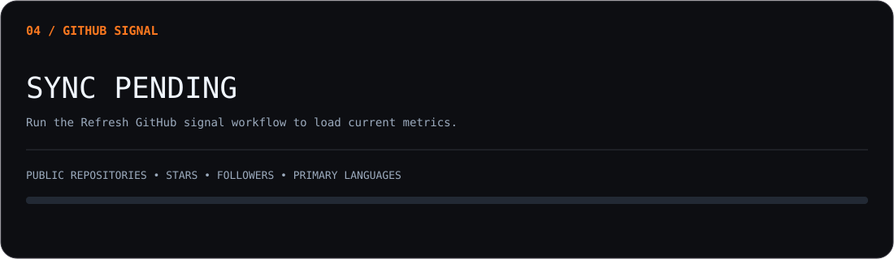

<div align="center">




[](https://github.com/Autistic-coder?tab=repositories)
[](https://leetcode.com/u/haalandcodes404/)


</div>

## `> about`

I'm **Vaibhav Bedi**, a B.Tech Computer Science student specializing in **Data Science** at **Bennett University (2024–2028)**, with a focus on **software development engineering, backend systems, system design, and applied machine learning**.


```text
PRIMARY INTERESTS   Software Engineering · Backend Development · System Design
APPLIED DOMAINS     Computer Vision · Machine Learning · Data Engineering
ENGINEERING FOCUS   API Design · Data Integrity · Testing · Production Workflows
```

## `> technical_skills`

<table>
<tr>
<td width="22%" valign="middle"><strong><code>LANGUAGES</code></strong></td>
<td width="78%" valign="middle">      </td>
</tr>
<tr>
<td width="22%" valign="middle"><strong><code>WEB + BACKEND</code></strong></td>
<td width="78%" valign="middle">      </td>
</tr>
<tr>
<td width="22%" valign="middle"><strong><code>AI + VISION</code></strong></td>
<td width="78%" valign="middle">      </td>
</tr>
<tr>
<td width="22%" valign="middle"><strong><code>DATA + DATABASES</code></strong></td>
<td width="78%" valign="middle">      </td>
</tr>
<tr>
<td width="22%" valign="middle"><strong><code>BIG DATA</code></strong></td>
<td width="78%" valign="middle">     </td>
</tr>
<tr>
<td width="22%" valign="middle"><strong><code>INFRA + TOOLS</code></strong></td>
<td width="78%" valign="middle">      </td>
</tr>
<tr>
<td width="22%" valign="middle"><strong><code>SYSTEMS + ENGINEERING</code></strong></td>
<td width="78%" valign="middle">       </td>
</tr>
</table>

<sub>Technologies used in projects, coursework, and applied engineering work. Experience varies by tool.</sub>

## `> selected_projects`

<table>
<tr>
<td width="50%" valign="top">

### [01 / VisionLine Inspector](https://github.com/Autistic-coder/visionline-inspector)

**Industrial Computer Vision · Automotive Inspection**

Dual-camera inspection application designed for automotive assembly operations. Integrates real-time object detection, operator-facing inspection states, and vehicle-linked logging.

**Engineering highlights**
- Dual RTSP streams and YOLOv8 inference
- Region-of-interest inspection and camera handling
- PySide6 desktop operator interface
- PLC-triggered workflow design and inspection logging

`Python` `PyTorch` `YOLOv8` `OpenCV` `PySide6`

[Explore repository](https://github.com/Autistic-coder/visionline-inspector)

</td>
<td width="50%" valign="top">

### [02 / MindMesh](https://github.com/Autistic-coder/mind-mesh)

**Full-Stack Development · Machine Learning Platform**

Multi-user workspace for dataset exploration, training, evaluation, model management, and predictions, built around account-level isolation and an accessible workflow.

**Engineering highlights**
- Authentication, authorization, and session security
- CSV/XLSX validation and dataset management
- Classification, regression, and held-out evaluation
- Saved models, batch prediction, and persistent storage

`React` `FastAPI` `scikit-learn` `PostgreSQL`

[Explore repository](https://github.com/Autistic-coder/mind-mesh)

</td>
</tr>
<tr>
<td width="50%" valign="top">

### [03 / Tor Project v2](https://github.com/Autistic-coder/tor_project_v2)

**Networking · Systems Exploration**

Implementation-focused exploration of networking and systems concepts, with an emphasis on practical experimentation and engineering fundamentals.

`Networking` `Systems` `Software Engineering`

[Explore repository](https://github.com/Autistic-coder/tor_project_v2)

</td>
<td width="50%" valign="top">

### [04 / LeetCode Solutions](https://github.com/Autistic-coder/leetcode-solutions-)

**Algorithms · Problem Solving**

Collection of implementations covering arrays, binary search, linked lists, trees, stacks, queues, recursion, and dynamic programming.

`C++` `Data Structures` `Algorithms`

[Explore repository](https://github.com/Autistic-coder/leetcode-solutions-)

</td>
</tr>
</table>

[View all repositories](https://github.com/Autistic-coder?tab=repositories)


## `> learning_next`

`Rust` · `Kubernetes` · `Google Cloud Platform` · `Linux Internals`

## `> github_signal`

<div align="center">
  
</div>


---

<div align="center"><sub>SOFTWARE ENGINEERING • APPLIED AI • SYSTEMS THAT WORK OUTSIDE THE DEMO</sub></div>
